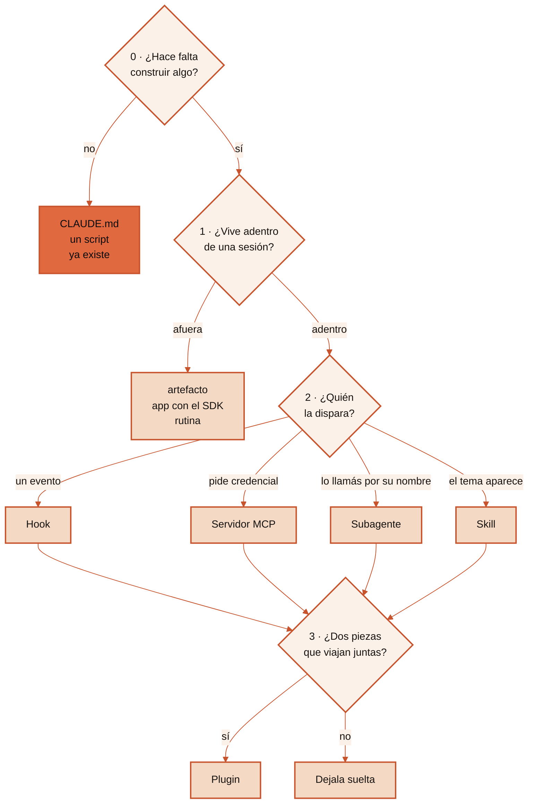

<p align="center">
  
</p>

<p align="center">
  <a href="https://github.com/Hainrixz/claude-anatomy/releases/latest"></a>
  <a href="LICENSE"></a>
  
  
</p>

<h1 align="center">Anatomía de Claude Code</h1>

<p align="center">
  Te dice qué construir en Claude Code —una skill, un subagente, un hook, un servidor MCP,<br>
  un plugin, una rutina, una página web, una app, o nada— y te da el esqueleto de archivos.
</p>

## El problema

Abrís Claude Code y hay skills, subagentes, comandos, plugins, servidores MCP,
hooks, canales, rutinas y artefactos. Nueve palabras, ninguna explicada, y una
decisión que hay que tomar en el minuto uno.

Lo más común es armar un subagente para algo que era un archivo de texto, o un
servidor MCP para algo que resolvía un script de veinte líneas.

El costo no se ve el primer día. Se ve al mes, cuando la sesión arranca pesada,
el modelo elige mal seguido, y nadie se acuerda de por qué esa carpeta está ahí.

## Qué hace

Corre cuatro pasos sobre tu caso y devuelve **una** pieza, con el motivo en una
frase y el árbol de archivos listo para completar.

Y hace algo que casi ninguna guía hace: empieza preguntando si hace falta
construir algo. Buena parte de los casos se resuelven con una línea en el
`CLAUDE.md`, instalando algo que ya existe, o con un script de veinte líneas.
Cuando la respuesta es esa, lo dice.

```
vos  › quiero revisar cuarenta archivos buscando problemas de seguridad
       y que me traiga solo los hallazgos

skill › Paso 2, pregunta 2.4 → es una SKILL, con `context: fork`.
        Corre en un subagente, así que los cuarenta archivos no entran
        a tu conversación.

        No hace falta escribir un subagente aparte: aislar el contexto
        dejó de ser un archivo y pasó a ser una línea del frontmatter.

        revision-de-seguridad/
          SKILL.md
          references/
```

## Dónde funciona

En los tres lados, con **el mismo archivo**: el `.zip` del Release.

| Dónde | Cómo se instala | Cuánto tarda |
|---|---|---|
| **Claude Code** — terminal, VS Code, JetBrains, escritorio, web | Dos comandos, o el `.zip` | Un minuto |
| **App de Claude** — chat en web, escritorio y celular | Subís el `.zip` en Customize | Un minuto |
| **Cowork y sesiones en la nube** — incluidas las rutinas | Se habilita desde tu cuenta | Ya está, si la subiste al chat |

Que ande fuera de Claude Code no es casualidad. Las skills siguen el estándar
abierto [Agent Skills](https://agentskills.io), que admite seis campos en el
frontmatter. Claude Code acepta bastantes más —`context: fork`,
`disable-model-invocation`, `argument-hint`— pero cualquiera de ésos hace fallar
la subida a claude.ai con un error duro, no lo ignora. Esta skill usa cuatro
campos y los cuatro están en el estándar, y el cuerpo no tiene nada exclusivo de
Claude Code: ni `$ARGUMENTS`, ni `${CLAUDE_SKILL_DIR}`, ni comandos embebidos.

## Instalación

### En Claude Code

Como plugin, sin descargar nada:

```
/plugin marketplace add Hainrixz/claude-anatomy
/plugin install claude-anatomy@claude-anatomy
```

O con el `.zip` del [último Release](https://github.com/Hainrixz/claude-anatomy/releases/latest):

```bash
mkdir -p .claude/skills
unzip claude-anatomy-skill-*.zip -d .claude/skills/
```

Eso la deja en el proyecto. Para tenerla en todos, descomprimila en la carpeta
de skills de tu configuración de usuario. La ruta de proyecto es reversible y la
de usuario no: por eso el default es proyecto.

También podés clonar el repo y copiar la carpeta a mano:

```bash
git clone https://github.com/Hainrixz/claude-anatomy
mkdir -p .claude/skills
cp -R claude-anatomy/skills/anatomia-cc .claude/skills/
```

### En la app de Claude

Sirve el mismo `.zip`, sin tocar nada.

1. Descargá `claude-anatomy-skill-*.zip` del [último Release](https://github.com/Hainrixz/claude-anatomy/releases/latest).
2. En la app, andá a **Customize → Skills**.
3. Tocá **+**, después **Crear skill**, y después **Subir una skill**.
4. Elegí el `.zip`. Listo.

Anda en los planes Free, Pro, Max, Team y Enterprise, siempre que tengas la
ejecución de código habilitada.

### En Cowork y en las sesiones en la nube

No hay un paso aparte: **Cowork usa las skills habilitadas en tu cuenta de
claude.ai**, así que con subirla al chat una vez ya la tenés en los dos. Se
administran desde **Customize** en la barra lateral de la app de escritorio, o
desde la configuración de skills en claude.ai. Se sincronizan al arrancar la
sesión.

> **La trampa que hace perder una tarde.** Cowork, las sesiones en la nube y las
> rutinas **no leen la carpeta de skills de tu máquina**. Si la instalaste solo
> ahí, una rutina que la invoque va a decir que la skill no existe, porque cada
> corrida arranca como una sesión remota nueva. Para que la vean: habilitala en
> tu cuenta de claude.ai, o —si es una sesión en la nube sobre un repo—
> commiteala en el `.claude/skills/` de ese repo.
>
> Las tareas programadas del escritorio son la excepción: corren en tu máquina y
> leen lo mismo que cualquier sesión local.

### Por qué la skill se llama `anatomia-cc` y el repo `claude-anatomy`

No es un descuido. Las superficies alojadas por Anthropic —la subida a
claude.ai, Cowork y la Skills API— **rechazan un `name` que contenga «claude» o
«anthropic»**, en cualquier posición. Es una reserva de marca: sirve para que
ninguna skill de terceros pueda hacerse pasar por oficial.

Claude Code no aplica esa regla, así que la primera versión de esta skill se
llamaba `claude-anatomy` y funcionaba perfecto ahí… y no subía a la app. El
nombre del repo, el del plugin y los comandos de instalación no tienen esa
restricción y por eso siguen igual.

Dos consecuencias prácticas para vos, si estás por publicar una skill:

- El `name` del frontmatter y **el nombre de la carpeta tienen que coincidir**.
  Eso lo pide la Skills API, no Claude Code: acá el `name` es solo la etiqueta y
  el comando sale del nombre de la carpeta. Si renombrás la carpeta en Claude
  Code, la skill sigue cargando y lo que cambia es el comando.
- El validador oficial `quick_validate.py` **no detecta la palabra reservada**.
  Empaqueta contento y el rechazo aparece recién al subir.

### Qué cambia en cada lado

En **Claude Code** te da la recomendación y el esqueleto de archivos, y seguís
de largo construyendo ahí mismo.

En la **app** y en **Cowork** te da la recomendación y el esqueleto como texto:
te sirve para decidir y para entender, y después vas a Claude Code a
construirlo. Sigue teniendo sentido, porque la duda —«¿esto es una skill o un
agente?»— suele aparecer antes de abrir la terminal.

## Cómo se usa

Se activa sola. Escribí lo que escribirías igual:

- «esto lo hago como skill o como agente?»
- «necesito un MCP o alcanza con una skill»
- «esto va como slash command o como skill?»
- «quiero que esto salga como una pantalla que le pueda mandar a alguien»
- «quiero meter esto adentro de mi app»
- «por dónde empiezo»

También dispara en inglés, con «should I build this as a skill or an agent».

## El árbol de decisión

Cuatro pasos. Adentro de cada uno, la primera pregunta que da «sí» cierra ese
paso.



<details>
<summary><b>El árbol completo en texto</b> — para copiar, o para leer con lector de pantalla</summary>

<br>

```
PASO 0 · ¿HACE FALTA CONSTRUIR ALGO?
  0.1 ¿Es que Claude se acuerde de una regla tuya?   SI -> CLAUDE.md
  0.2 ¿Ya lo hizo otro?                              SI -> instalalo
  0.3 ¿Te molesta CÓMO contesta, no lo que sabe?     SI -> estilo de salida
  0.4 ¿Lo resuelve un script, sin modelo adentro?    SI -> script

PASO 1 · ¿ADENTRO DE UNA SESIÓN, O AFUERA?
  1.1 ¿Se entrega una pantalla que alguien mira?     SI -> artefacto
  1.2 ¿Lo usa gente que no abre Claude Code?         SI -> app, Agent SDK
  1.3 ¿Corre con tu computadora apagada?             SI -> rutina en la nube

PASO 2 · QUÉ PIEZA
  2.1 ¿Tiene que pasar SIEMPRE, sin criterio?        SI -> hook
  2.2 ¿Entra a un sistema con credencial propia?     SI -> servidor MCP
  2.3 ¿Es un trabajador reusable, con nombre?        SI -> subagente
  2.4 Lo que queda                                      -> SKILL, y su modo

PASO 3 · ¿SE EMPAQUETA?  (siempre, al final)
  3.1 ¿Dos o más piezas que viajan juntas, o tiene
      que andar en otra máquina?                     SI -> plugin
                                                     NO -> dejalo suelto
```
</details>

## Los cuatro modos de una skill

Esto es lo que más desactualiza al material escrito hace unos meses: **el comando
de barra y el subagente dejaron de ser piezas aparte y pasaron a ser campos del
frontmatter.**

| | La disparás vos | La dispara el modelo | Las dos |
|---|---|---|---|
| **Corre en tu conversación** | `disable-model-invocation: true` | `user-invocable: false` | el default |
| **Corre aparte** | `disable-model-invocation` + `context: fork` | `context: fork` | `context: fork` |

Un archivo en `.claude/commands/deploy.md` y una skill en
`.claude/skills/deploy/SKILL.md` producen los dos el mismo `/deploy`. Lo que ya
tenías escrito sigue funcionando; para algo nuevo, la skill además admite
archivos de apoyo.

## Qué carga contexto y qué no

Casi todas las piezas pueden hacer casi lo mismo. Lo que las separa es qué te
cobran y cuándo.

| Pieza | En el turno cero | Después |
|---|---|---|
| `CLAUDE.md` | Entero, siempre | — |
| Regla con `paths:` | Nada | Cuando Claude toca esos archivos |
| Skill | Una línea de descripción | El cuerpo al disparar, y ahí se queda |
| Skill con `disable-model-invocation` | Nada | Todo, al invocarla vos |
| Servidor MCP | Los nombres de las herramientas | El esquema, cuando se usa |
| Subagente | Nada tuyo | Corre en su ventana y devuelve el resumen |
| Hook | Nada | Solo lo que imprima |

La fila del MCP es la que más cambió. El consejo viejo era no instalar servidores
porque los esquemas te comían el contexto en cada turno. Hoy la búsqueda de
herramientas los difiere, así que lo que empeora con cuarenta herramientas no es
el gasto: es que el modelo elige peor entre cuarenta nombres parecidos que entre
seis.

## Los anti-patrones más comunes

| Anti-patrón | Qué hacer en su lugar |
|---|---|
| Un comando de barra para algo nuevo | Skill con `disable-model-invocation` |
| Un subagente aparte solo para aislar contexto | `context: fork` en la skill que ya tenías |
| Un MCP con cuarenta herramientas por las dudas | Las operaciones que alguien pidió |
| Una skill que pide una clave de API | MCP abajo, skill de criterio arriba |
| Un plugin con una sola skill que usás solo vos | Dejala suelta |
| Un hook que decide con criterio | Hook para la regla fija, skill para el juicio |
| Una regla importante escrita en el `CLAUDE.md` | Si tiene que valer siempre, es un hook |
| Pedir un artefacto esperando una app | Si guarda datos, la hospedás vos |

Los once, con el antes y el después de cada uno, están en
[`references/anti-patrones.md`](skills/anatomia-cc/references/anti-patrones.md).

## Qué hay adentro

```
skills/anatomia-cc/
├── SKILL.md                          el árbol y el contrato de salida
├── references/                       se leen solo si hacen falta
│   ├── como-se-carga-el-contexto.md  qué entra en el turno cero, y qué no
│   ├── modos-de-skill.md             los cuatro modos y el frontmatter entero
│   ├── mcp-o-skill.md                la señal de la credencial
│   ├── afuera-de-la-sesion.md        artefacto, app con el SDK, rutina, workflow
│   └── anti-patrones.md              los once, con antes y después
├── assets/                           se copian, no se leen
│   ├── arbol-de-decision.md          el árbol entero en una página
│   └── esqueleto-*.md                ocho esqueletos, uno por pieza
└── evals/
    ├── evals.json                    20 pruebas de disparo
    └── decisiones.json               12 pruebas de decisión
```

## Lo que NO hace y por qué

No escribe la pieza entera. Entrega la recomendación y el esqueleto. Completarlo
es otro trabajo, o el de `skill-smith` si la pieza elegida es una skill.

No reemplaza la documentación oficial, que cambia seguido. Esta versión se
escribió contra la documentación de agosto de 2026 y verificó contra ella cada
afirmación sobre orden de carga, costo de contexto, campos del frontmatter,
eventos de hook y límites de un artefacto. Lo que vayas a apoyar en un número,
verificalo contra la de hoy.

No decide si conviene automatizar algo. Esa pregunta es anterior a ésta: acá se
asume que ya decidiste construir, y falta elegir la forma.

## De dónde salió

De una caja de preguntas en Instagram que contestaron 712 personas. Este producto
tiene una demanda medida de 14 y cinco respuestas registradas como su origen; en
[CITAS.md](CITAS.md) está la diferencia entre esos dos números y los cinco
identificadores. No se publica el texto de ningún comentario ni el usuario de
nadie.

## Cómo se verificó

La compuerta `validar_artefacto.py` corrió sobre esta versión y dio `pass`, con
cero errores y cero avisos. Revisa el frontmatter, los límites de la descripción,
que todos los enlaces relativos resuelvan, que no viaje ninguna credencial ni
ninguna ruta de la máquina del autor, y que las citas resuelvan contra el corpus.

Hay dos sets de pruebas en [`evals/`](skills/anatomia-cc/evals):

| Archivo | Qué mide | Casos | Estado |
|---|---|---|---|
| `evals.json` | Si la skill se activa cuando corresponde | 10 + 10 | Escrito, sin ejecutar |
| `decisiones.json` | Si la recomendación es la correcta | 12 | Escrito, sin ejecutar |

Están escritos y **no ejecutados**. Es la diferencia entre una compuerta que
corrió y una prueba que no: lo primero está verificado, lo segundo no.

## Licencia

MIT — ver [LICENSE](LICENSE).

Proyecto de la comunidad, construido con la forja de [tododeia.com](https://www.tododeia.com).
**No afiliado a Anthropic.**
