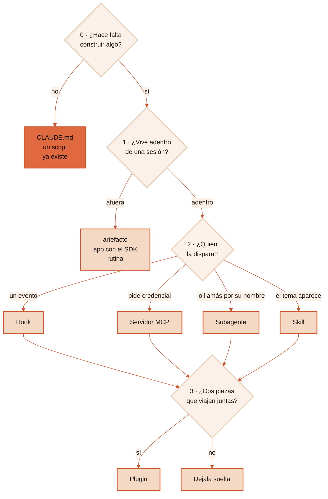

<p align="center">
  
</p>

# Anatomía de Claude Code

Te dice qué tenés que construir en Claude Code —una skill, un subagente, un
hook, un servidor MCP, un plugin, una rutina, una página web, una app, o nada— y
te da el esqueleto de archivos de la pieza que salió.

## El problema

Abrís Claude Code y hay skills, subagentes, comandos, plugins, servidores MCP,
hooks, canales, rutinas y artefactos. Nueve palabras, ninguna explicada, y una
decisión que hay que tomar en el minuto uno.

Lo más común es armar un subagente para algo que era un archivo de texto, o un
servidor MCP para algo que resolvía un script de veinte líneas.

El costo no se ve el primer día. Se ve al mes, cuando la sesión arranca pesada,
el modelo elige mal seguido, y nadie se acuerda de por qué esa carpeta está ahí.

## Qué hace

Corre cuatro pasos sobre el caso que trajiste y devuelve **una** pieza, con el
motivo en una frase y el árbol de archivos listo para completar.

Y hace algo que casi ninguna guía hace: empieza preguntando si hace falta
construir algo. Buena parte de los casos que llegan se resuelven con una línea en
el `CLAUDE.md`, instalando algo que ya existe, o con un script de veinte líneas.
Cuando la respuesta es esa, lo dice.

Se ve así:

```
vos  › quiero revisar cuarenta archivos buscando problemas de seguridad
       y que me traiga solo los hallazgos

skill › Paso 2, pregunta 2.4 → es una SKILL, con `context: fork`.
        Corre en un subagente, así que los cuarenta archivos no entran
        a tu conversación.

        No hace falta escribir un subagente aparte: aislar el contexto
        dejó de ser un archivo y pasó a ser una línea del frontmatter.

        revision-de-seguridad/
          SKILL.md
          references/
```

## El árbol de decisión

Cuatro pasos. Adentro de cada uno, la primera pregunta que da «sí» cierra ese
paso.



<details>
<summary>El árbol completo en texto, para copiar o para leer con lector de pantalla</summary>

```
PASO 0 · ¿HACE FALTA CONSTRUIR ALGO?
  0.1 ¿Es que Claude se acuerde de una regla tuya?   SI -> CLAUDE.md
  0.2 ¿Ya lo hizo otro?                              SI -> instalalo
  0.3 ¿Te molesta CÓMO contesta, no lo que sabe?     SI -> estilo de salida
  0.4 ¿Lo resuelve un script, sin modelo adentro?    SI -> script

PASO 1 · ¿ADENTRO DE UNA SESIÓN, O AFUERA?
  1.1 ¿Se entrega una pantalla que alguien mira?     SI -> artefacto
  1.2 ¿Lo usa gente que no abre Claude Code?         SI -> app, Agent SDK
  1.3 ¿Corre con tu computadora apagada?             SI -> rutina en la nube

PASO 2 · QUÉ PIEZA
  2.1 ¿Tiene que pasar SIEMPRE, sin criterio?        SI -> hook
  2.2 ¿Entra a un sistema con credencial propia?     SI -> servidor MCP
  2.3 ¿Es un trabajador reusable, con nombre?        SI -> subagente
  2.4 Lo que queda                                      -> SKILL, y su modo

PASO 3 · ¿SE EMPAQUETA?  (siempre, al final)
  3.1 ¿Dos o más piezas que viajan juntas, o tiene
      que andar en otra máquina?                     SI -> plugin
                                                     NO -> dejalo suelto
```
</details>

## Los cuatro modos de una skill

Esto es lo que más desactualiza al material escrito hace unos meses: **el comando
de barra y el subagente dejaron de ser piezas aparte y pasaron a ser campos del
frontmatter.**

| | La disparás vos | La dispara el modelo | Las dos |
|---|---|---|---|
| **Corre en tu conversación** | `disable-model-invocation: true` | `user-invocable: false` | el default |
| **Corre aparte** | `disable-model-invocation` + `context: fork` | `context: fork` | `context: fork` |

Un archivo en `.claude/commands/deploy.md` y una skill en
`.claude/skills/deploy/SKILL.md` producen los dos el mismo `/deploy`. Lo que ya
tenías escrito sigue funcionando; para algo nuevo, la skill además admite
archivos de apoyo.

## Qué carga contexto y qué no

Casi todas las piezas pueden hacer casi lo mismo. Lo que las separa es qué te
cobran y cuándo.

| Pieza | En el turno cero | Después |
|---|---|---|
| `CLAUDE.md` | Entero, siempre | — |
| Regla con `paths:` | Nada | Cuando Claude toca esos archivos |
| Skill | Una línea de descripción | El cuerpo al disparar, y ahí se queda |
| Skill con `disable-model-invocation` | Nada | Todo, al invocarla vos |
| Servidor MCP | Los nombres de las herramientas | El esquema, cuando se usa |
| Subagente | Nada tuyo | Corre en su ventana y devuelve el resumen |
| Hook | Nada | Solo lo que imprima |

La fila del MCP es la que más cambió. El consejo viejo era no instalar servidores
porque los esquemas te comían el contexto en cada turno. Hoy la búsqueda de
herramientas los difiere, así que lo que empeora con cuarenta herramientas no es
el gasto: es que el modelo elige peor entre cuarenta nombres parecidos que entre
seis.

## Cómo se instala

Como plugin, con dos comandos adentro de Claude Code:

```
/plugin marketplace add Hainrixz/claude-anatomy
/plugin install claude-anatomy@claude-anatomy
```

O clonando el repo y copiando la carpeta al proyecto:

```bash
mkdir -p .claude/skills
cp -R skills/claude-anatomy .claude/skills/
```

Para tenerla en todos tus proyectos, copiala a la carpeta de skills de tu
configuración de usuario en vez de a la del proyecto. La ruta de proyecto es
reversible y la de usuario no: por eso el default es proyecto.

La carpeta se llama igual que el `name` del frontmatter. Si la renombrás, la
skill no carga.

## Cómo se usa

Se invoca sola. Escribí lo que escribirías igual:

- «esto lo hago como skill o como agente?»
- «necesito un MCP o alcanza con una skill»
- «esto va como slash command o como skill?»
- «quiero que esto salga como una pantalla que le pueda mandar a alguien»
- «quiero meter esto adentro de mi app»
- «por dónde empiezo»

También dispara en inglés, con «should I build this as a skill or an agent».

## Los anti-patrones más comunes

| Anti-patrón | Qué hacer en su lugar |
|---|---|
| Un comando de barra para algo nuevo | Skill con `disable-model-invocation` |
| Un subagente aparte solo para aislar contexto | `context: fork` en la skill que ya tenías |
| Un MCP con cuarenta herramientas por las dudas | Las operaciones que alguien pidió |
| Una skill que pide una clave de API | MCP abajo, skill de criterio arriba |
| Un plugin con una sola skill que usás solo vos | Dejala suelta |
| Un hook que decide con criterio | Hook para la regla fija, skill para el juicio |
| Una regla importante escrita en el `CLAUDE.md` | Si tiene que valer siempre, es un hook |
| Pedir un artefacto esperando una app | Si guarda datos, la hospedás vos |

Los once, con el antes y el después de cada uno, están en
`skills/claude-anatomy/references/anti-patrones.md`.

## Lo que NO hace y por qué

No escribe la pieza entera. Entrega la recomendación y el esqueleto. Completarlo
es otro trabajo, o el de `skill-smith` si la pieza elegida es una skill.

No reemplaza la documentación oficial, que cambia seguido. Esta versión se
escribió contra la documentación de agosto de 2026 y verificó contra ella cada
afirmación sobre orden de carga, costo de contexto y campos del frontmatter. Lo
que vayas a apoyar en un número, verificalo contra la de hoy.

No decide si conviene automatizar algo. Esa pregunta es anterior a ésta: acá se
asume que ya decidiste construir, y falta elegir la forma.

## De dónde salió

Lo pidieron 14 personas que contestaron una caja de preguntas. Los
identificadores están en [CITAS.md](CITAS.md). No se publica el texto de ningún
comentario ni el usuario de nadie.

## Cómo se verificó

La compuerta `validar_artefacto.py` corrió sobre esta versión y dio `pass`, con
cero errores. Revisa el frontmatter, los límites de la descripción, que todos los
enlaces relativos resuelvan, que no viaje ninguna credencial ni ninguna ruta de
la máquina del autor, y que las citas resuelvan contra el corpus.

Hay dos sets de pruebas adentro de `skills/claude-anatomy/evals/`:

- `evals.json` — 20 casos de disparo: 10 que tienen que activar la skill y 10
  que no.
- `decisiones.json` — 12 casos que miden si la recomendación es la correcta, no
  solo si la skill se activó.

Los dos están escritos y **no ejecutados**. Es la diferencia entre una compuerta
que corrió y una prueba que no: lo primero está verificado, lo segundo no.

## Licencia

MIT.

Este es un proyecto de la comunidad. **No afiliado a Anthropic.**
